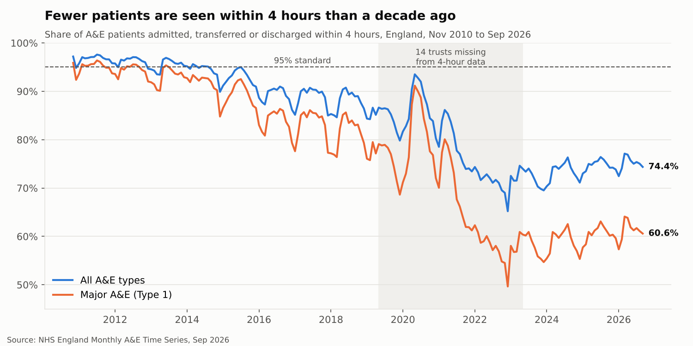
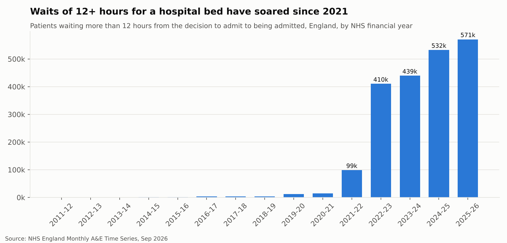

# NHS A&E Performance Analysis (England, 2010–2026)

An end-to-end analysis of NHS England's official A&E statistics, the kind of work an NHS performance analyst does every month. It covers demand, the 4-hour standard and long waits for a hospital bed, from November 2010 to September 2026.

**Skills shown:** SQL (joins, CTEs, window functions, data-quality reconciliation) · Excel (SUMIFS, INDEX/MATCH, AVERAGEIFS, data validation, conditional formatting, charts) · Power BI (star schema, DAX) · Python (pandas data cleaning) · plain-English reporting for non-technical readers

---

## Headline findings



- **Demand is up 29%:** from 21.6 million attendances in 2011-12 to 28.0 million in 2025-26.
- **The 95% standard was last met in July 2015.** In 2025-26, 60.9% of patients in major (Type 1) A&E were seen within 4 hours, against 94.9% in 2011-12.
- **Waits of 12+ hours for a bed are 175 times their 2018-19 level:** 570,957 in 2025-26. The share of patients needing admission hasn't changed much, which points to bed flow, not demand mix, as the bottleneck.
- **December is the hardest month:** major A&E performance averages 54.8%, against about 60–61% from March to August.
- **Partial recovery:** major A&E performance has risen from 56.7% (2022-23) to 60.9% (2025-26) while attendances grew by 10%.



Full write-up with recommendations: **[report/findings.md](report/findings.md)**

## Approach

```
NHS England XLS ──► Python cleaning ──► star schema (CSV) ──┬──► SQL analysis (SQLite)
                                                            ├──► Excel workbook
                                                            └──► Power BI dashboard
```

1. **Cleaning** ([`src/clean_data.py`](src/clean_data.py)): reads the three data sheets of the official spreadsheet and converts Excel dates. It rounds the estimated (fractional) early months, adds NHS financial years and seasons, and flags the four data-quality caveats from the source notes. It also checks that department-type totals add up.
2. **Data model:** a star schema with one dimension table (`dim_month`) and three fact tables (`fact_activity`, `fact_performance`, `fact_booked`), keyed on `month_key` (YYYYMM). The same model feeds SQL, Excel and Power BI.
3. **SQL** ([`sql/`](sql)): eight queries, each answering one business question:

   | Query | Question | Techniques |
   |---|---|---|
   | [01](sql/01_latest_month_vs_last_year.sql) | Latest month vs same month last year | JOIN, `LAG` window |
   | [02](sql/02_financial_year_summary.sql) | Year-by-year demand and performance | GROUP BY, HAVING |
   | [03](sql/03_monthly_trend_rolling.sql) | Underlying trend (12-month rolling) | `AVG/SUM OVER (ROWS BETWEEN)`, named WINDOW |
   | [04](sql/04_worst_months_ranked.sql) | Ten worst months for major A&E | CTE, `RANK` |
   | [05](sql/05_seasonality.sql) | Seasonal pattern | subquery, CASE |
   | [06](sql/06_department_type_gap.sql) | Major vs minor A&E gap | derived metrics |
   | [07](sql/07_admissions_and_long_waits.sql) | Admissions and 12-hour waits | `LAG`, `NULLIF` |
   | [08](sql/08_data_quality_checks.sql) | Can the data be trusted? | LEFT JOIN anti-join, reconciliation |

4. **Excel** ([`excel/NHS_AE_Analysis.xlsx`](excel/NHS_AE_Analysis.xlsx)): every figure is a live formula over the Data sheet:
   - *FY Summary*: SUMIFS/COUNTIFS by financial year, highlighting below the 95% standard, two charts
   - *Month Lookup*: pick any month from a drop-down; INDEX/MATCH and EDATE pull the same month last year
   - *Seasonality*: AVERAGEIFS over an adjustable date window
5. **Power BI** ([`powerbi/`](powerbi)): data model, [DAX measures](powerbi/measures.dax) and a [build guide](powerbi/POWER_BI_GUIDE.md) for a four-page dashboard.

The SQL results and Excel formulas were cross-checked and give identical figures. The Power BI guide lists the expected values so the dashboard can be checked against them too.

## A data-quality check worth mentioning

Query 08 found **49 months where the 4-hour counts don't add up to total attendances**. Those are exactly the 49 months (May 2019 to May 2023) when, according to the source notes, 14 trusts were testing new standards and left out of the 4-hour data. The check confirms the caveat. It also means 4-hour performance from that period should be compared with care, so the charts shade that period.

## How to run

```bash
pip install -r requirements.txt
python src/clean_data.py      # raw XLS -> data/clean/*.csv
python src/run_sql.py         # builds data/nhs_ae.db, runs sql/*.sql -> outputs/*.csv
python src/make_charts.py     # charts/*.png
python src/build_excel.py     # excel/NHS_AE_Analysis.xlsx
```

To update with a newer month, download the latest *Monthly A&E Time Series* from the [NHS England A&E statistics page](https://www.england.nhs.uk/statistics/statistical-work-areas/ae-waiting-times-and-activity/), put it in `data/raw/`, update the filename in `src/clean_data.py`, and re-run.

## Repository structure

```
data/raw/        original NHS England spreadsheet
data/clean/      star-schema CSVs (dimension + facts)
sql/             schema and 8 analysis queries
src/             Python: cleaning, SQL runner, charts, Excel builder
outputs/         query results as CSV
charts/          charts used in this README
excel/           Excel workbook
powerbi/         DAX measures and dashboard build guide
report/          findings write-up
```

## Data source and caveats

NHS England, *Monthly A&E Time Series September 2026*, published 8 October 2026. Contains public sector information licensed under the [Open Government Licence v3.0](https://www.nationalarchives.gov.uk/doc/open-government-licence/version/3/).

- Nov 2010 to May 2015 are estimated by NHS England from weekly data.
- May 2019 to May 2023: 14 trusts missing from the 4-hour figures (see above).
- From Aug 2020, attendances include booked appointments.
- Aug 2022 to Feb 2023: Type 3 attendances understated after a cyber-attack.
